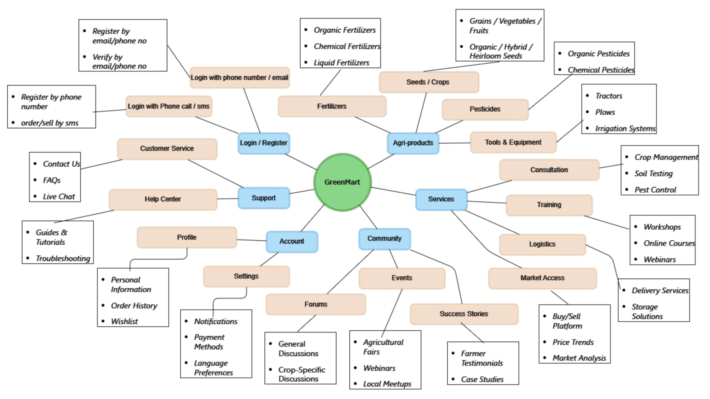
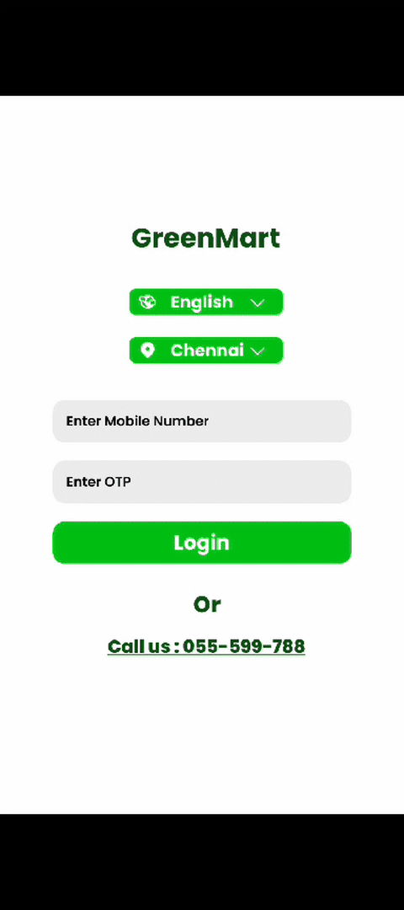

# 🌱 GreenMart - Your Digital Agriculture Marketplace

<div align="center">

[](https://reactjs.org/)
[](https://vitejs.dev/)
[](LICENSE)
[](https://github.com/mohanapriyan2006/greenmart)

*Connecting farmers, buyers, and agricultural communities through innovative technology*

[🚀 Get Started](#-getting-started) • [✨ Features](#-features) • [📖 Documentation](#-documentation) • [🤝 Contributing](#-contributing)

</div>

---

## 🌿 GreenMart


-----

## 🌟 What is GreenMart?

GreenMart is a comprehensive **digital agriculture marketplace** built with React.js that revolutionizes how farmers, buyers, and agricultural communities connect and trade. Our platform bridges the gap between traditional farming and modern technology, creating a seamless ecosystem for agricultural commerce.

### 🎯 Our Mission
To empower farmers with digital tools, connect them directly with buyers, eliminate middlemen, and create a transparent, efficient agricultural marketplace that benefits everyone in the supply chain.

----

## Mindmap 



----

## ✨ Features

### 🏠 **Smart Home Dashboard**
- **Weather Integration**: Real-time weather updates to help plan farming activities
- **Quick Search**: Find services, products, and farmers instantly
- **Agricultural Schemes**: Stay updated with government schemes and subsidies
- **Personalized Recommendations**: Get suggestions based on your location and preferences

### 👨‍🌾 **Farmer Network**
- **Connect with Local Farmers**: Browse and message farmers in your area
- **Crop Information**: View primary crops and farming specialties
- **Location-Based Discovery**: Find farmers near you with GPS integration
- **Direct Communication**: Built-in messaging system for seamless communication

### 🛒 **Smart Marketplace**
- **Local Marketplace**: Buy fresh produce directly from local farmers
- **Bulk Import/Export**: Handle large-scale agricultural trading
- **Product Categories**: Organized listings for seeds, fertilizers, tools, and produce
- **Rating System**: Review and rate products and sellers

### 🛍️ **Enhanced Shopping Experience**
- **Shopping Cart**: Easy cart management with quantity controls
- **Wishlist**: Save products for later purchase
- **Order History**: Track your previous purchases
- **Multiple Payment Options**: Secure payment processing

### 💳 **Flexible Payment Solutions**
- **Digital Payments**: Support for UPI, cards, and digital wallets
- **Google Pay Integration**: Quick and secure payments
- **Payment History**: Track all your transactions
- **Secure Processing**: Bank-level security for all transactions

### 📚 **Learning & Support**
- **Tutorial Center**: Video guides on using the platform
- **Agricultural Tips**: Expert advice and farming techniques
- **Multi-language Support**: Available in English, Tamil, Hindi, and 6 other regional languages
- **Customer Support**: 24/7 helpline for assistance

### ⚙️ **Smart Settings**
- **Profile Management**: Update your personal and business information
- **Location Settings**: Set your preferred location and delivery areas
- **Notification Preferences**: Customize alerts and updates
- **Privacy Controls**: Manage your data and privacy settings


---

## Demo



---

## 🚀 Getting Started

### Prerequisites
- **Node.js** (v16.0 or higher)
- **npm** or **yarn** package manager
- Modern web browser (Chrome, Firefox, Safari, Edge)

### Installation

1. **Clone the repository**
   ```bash
   git clone https://github.com/mohanapriyan2006/greenmart.git
   cd greenmart
   ```

2. **Install dependencies**
   ```bash
   npm install
   ```

3. **Start the development server**
   ```bash
   npm run dev
   ```

4. **Open your browser**
   ```
   Navigate to http://localhost:5173
   ```

### Build for Production

```bash
# Build the project
npm run build

# Preview the production build
npm run preview
```

---

## 📱 Application Architecture

### 🗂️ Project Structure
```
greenmart/
├── 📁 src/
│   ├── 📁 Components/          # React components
│   │   ├── 🏠 Home.jsx         # Dashboard & main page
│   │   ├── 👨‍🌾 Farmer.jsx        # Farmer network
│   │   ├── 🛒 Market.jsx       # Marketplace hub
│   │   ├── 🛍️ Products.jsx     # Product listings
│   │   ├── 🛒 Cart.jsx         # Shopping cart
│   │   ├── 💳 Payments.jsx     # Payment processing
│   │   ├── 📊 Import_Export.jsx # Bulk trading
│   │   ├── ⚙️ Settings.jsx     # User settings
│   │   ├── 📚 Tutor.jsx        # Learning center
│   │   └── 🔐 Login.jsx        # Authentication
│   ├── 📁 style/               # CSS stylesheets
│   ├── 📁 assets/              # Images & icons
│   └── 📄 App.jsx              # Main application component
├── 📄 package.json             # Dependencies & scripts
├── 📄 vite.config.js          # Vite configuration
└── 📄 index.html              # HTML template
```

### 🛠️ Technology Stack
- **Frontend Framework**: React 18.3.1
- **Build Tool**: Vite 5.4.1
- **Routing**: React Router DOM 6.26.1
- **Styling**: Custom CSS with Montserrat font
- **Code Quality**: ESLint for code linting
- **Package Manager**: npm

### 🌐 Key Components
- **Responsive Design**: Mobile-first approach optimized for agricultural communities
- **Progressive Web App**: Works offline and provides app-like experience
- **Multi-language Support**: Localized for Indian regional languages
- **Real-time Updates**: Live weather and market data integration

---


## 🎨 Design Philosophy

### 🟢 **Green Theme**
Our design uses a fresh green color palette (`#00c013`, `#b1edb3`) representing nature, growth, and agriculture.

### 📱 **Mobile-First**
Designed primarily for mobile devices (425x643px) to ensure accessibility for farmers who primarily use smartphones.

### 🎯 **User-Centric**
Simple, intuitive interface designed for users with varying levels of technical expertise.

### ♿ **Accessibility**
Built with accessibility in mind, ensuring the platform is usable by everyone in the agricultural community.

---

<div align="center">

**Made with ❤️ for the agricultural community**

[⭐ Star this project](https://github.com/mohanapriyan2006/greenmart) • [🍴 Fork it](https://github.com/mohanapriyan2006/greenmart/fork) • [📢 Share it](https://twitter.com/intent/tweet?text=Check%20out%20GreenMart%20-%20A%20digital%20agriculture%20marketplace!&url=https://github.com/mohanapriyan2006/greenmart)

*Empowering agriculture through technology* 🌱

</div>
